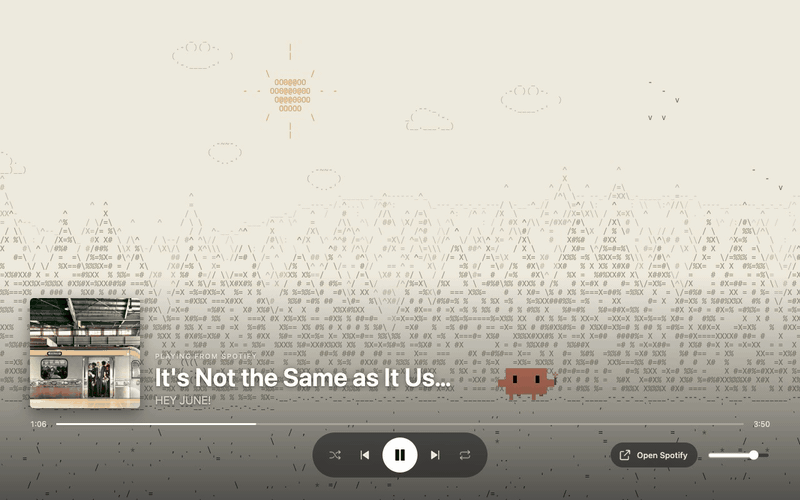

# Wanderer

An ambient ASCII world to study to. Clawd the crab travels through six biomes (forest, rolling hills, town, lake, under the sea, a mountain dome) under a sky that follows your real clock, while the song playing in your Spotify app shows in a TV-style player.



## Requirements

- [Node.js](https://nodejs.org) 20.19+ or 22.12+
- macOS with the Spotify desktop app, for the music player (optional: the scenery runs without it)

## Run it

```bash
git clone https://github.com/kekidev/wanderer.git
cd wanderer
npm install
npm run dev
```

Open http://127.0.0.1:5173 and press `F` for full screen. Stop it with `Ctrl+C` in the terminal.

The first time it runs, macOS asks to let Terminal control Spotify; click **Allow**. Then play anything in Spotify and Wanderer follows along. To change songs, click the list icon (or press `O`) to bring Spotify to the front.

## Controls

| Key | Does |
|---|---|
| `M` | next biome |
| `F` | full screen |
| `Space` | play / pause |
| `←` `→` | previous / next song |
| `O` | open the Spotify app to pick music |

## Options

Add these to the URL:

| URL | Does |
|---|---|
| `?switch=song` | change biome on every new song (default: every 6 minutes) |
| `?hour=22` | pin the time of day, e.g. to preview night |

## How it works

- **Scenes**: `public/design/` holds the scene engine from the Wanderer v2 design. The only changes are a `pipX` option for the character's position and `clawd.js`, which swaps in Clawd and re-anchors the props.
- **Spotify**: `bridge/server.mjs` reads the desktop app through AppleScript, so it needs no login, works on Spotify Free, and only sees music playing on this Mac. Nothing is sent anywhere.
- **App**: `src/` runs the biome timer, keyboard controls and the player.

Other commands: `npm test` runs the tests, `npm run build` makes a production build in `dist/`.

## Credits

Clawd's sprite is from [clawd-tank](https://github.com/marciogranzotto/clawd-tank) by Marcio Granzotto Rodrigues (MIT license).
